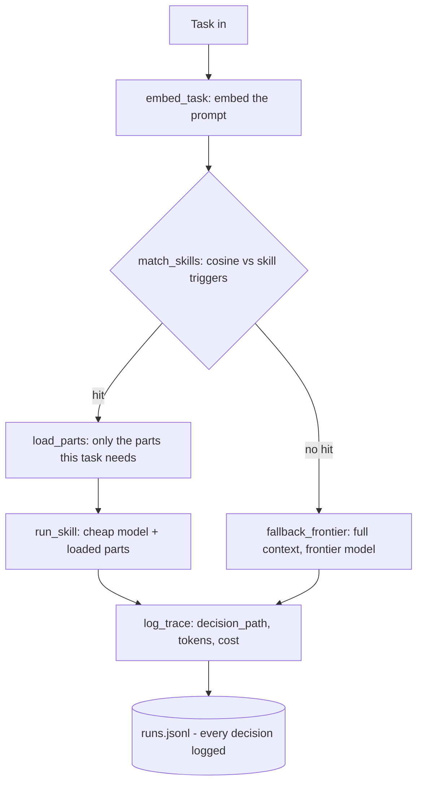
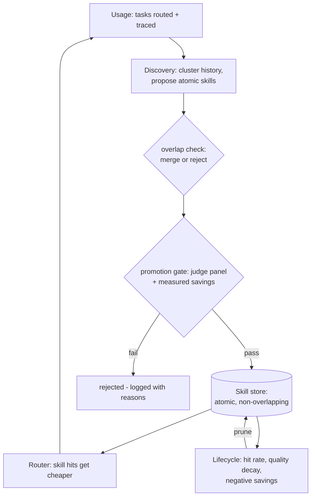

# Muscle Memory for AI Agents

Your coding agent repeats itself. It writes the same kinds of commit messages, explains the same
kinds of stack traces, triages the same kinds of issues - and pays frontier-model prices for
every single one.

**Muscle Memory** watches what your agent actually does, discovers the workflows it repeats
(without being told), compiles them into cheap reusable skills, and prunes the ones that stop
paying off. The longer it runs, the cheaper it gets - and a judge panel proves it doesn't get dumber.

Built at CalHacks 13 (Oct 24-25, 2026). Everything below is from measured live runs
(Claude sonnet-4.5 frontier path, Claude haiku-4.5 skill + judge path, Gemini embeddings) -
no projections, no mock numbers.

## How a task is routed



## How the system learns



No human labels anything. Discovery never sees the corpus's type labels - it clusters raw
prompt+context embeddings. The promotion gate is code, not vibes: a 3-member LLM judge panel
scores the skill path against the frontier path on held-out tasks, and the skill must also
show measured positive savings. Skills are atomic and non-overlapping - the overlap check
merges or rejects lookalikes before they enter the store.

## Measured evidence

Latest take (2026-10-24, live Anthropic + gemini-embedding-2): **120 runs, $0.830 total spend,
5 candidates judged, 4 skills promoted, 1 rejected by the gate.** Every gate decision is in
`src/traces/discovery.jsonl` with its scores; the full evidence set is in `demo/VERIFICATION.md`.

- Cost: frontier avg **$0.0076/task** vs skill avg **$0.0027/task** = **65% cheaper** on routed
  tasks. The gate's own measured validation savings: $0.0016-$0.0046/task per promoted skill.
- Quality: 12 judged pairs at the gate - 4 skill wins, 3 frontier wins, 5 ties (means 0.902
  frontier vs 0.853 skill across the full candidate set, which includes the rejected one).
- The gate rejects: `skill-draft-release-notes` measured mean judge **0.67** (< 0.75) despite
  positive measured savings - not promoted. On an earlier take under the strict all-pairs-pass
  default, **all four candidates were rejected**, including one skill that tried to refuse a task
  outside its competence. The demo take runs visibly with `--allow-partial-pass` (mean >= 0.75,
  same bar, disclosed on screen and in every run summary).
- The lifecycle retires a bad skill (earlier take): the unit-test skill passed the gate, then
  measured **$0.0104/run vs $0.0075/run frontier** in production and was **pruned automatically**
  - decision and measured reasons in `src/traces/lifecycle.jsonl`.

## The ablation: does plain haiku beat the whole system?

The obvious counter-claim: "skip the skill system, just run everything on the cheap model." We
ran it live - all 40 corpus tasks, three arms: **plain haiku** (full context, no skill sheet),
**skill path** (router match + selective parts + haiku), **frontier** (sonnet, full context).
Judged head-to-head by the 3-stance panel with the balanced stance on Sonnet
(`MUSCLE_MEMORY_PANEL_MODELS`), so haiku never grades its own work alone. Full records:
`demo/verification_evidence.json` -> `ablation`.

Measured result - **on this corpus, plain haiku is competitive, and we say so:**

| arm | avg cost | avg tokens_in |
|---|---|---|
| plain haiku (no skill) | $0.0023 | 171 |
| skill path | $0.0024 | 526 |
| frontier | $0.0072 | 171 |

- plain vs frontier: **plain 0.912 vs frontier 0.900** (15 plain / 11 frontier / 14 ties). These
  are short-context tasks; haiku full-context matches sonnet here, so the 65% saving over
  frontier is a model-tier saving, not a skill-mechanism saving.
- plain vs skill (22 skill-routed): **plain 0.900 vs skill 0.879** (7 skill / 8 plain / 7 ties).
  A wash on average.
- **Where the skill system wins decisively: issue triage** - skill **0.918** vs plain **0.807**
  vs frontier **0.808**, at $0.0016 vs $0.0055 frontier. Specialized instructions beat both
  models' generic answers on quality and cost at once.
- Where it hurts: commit-message tasks that matched the neighboring PR-description skill scored
  0.782 vs 0.889 plain - a wrong-skill route is measurably worse than no skill, which is exactly
  what the keep/retire lifecycle exists to catch on real traffic.

What the skill layer is actually for, given these numbers: on small-context tasks a cheap model
with full context is enough, and the honest margin is specialization on workflows like triage.
The architectural payoff - loading 3 of 4 parts *instead of* a growing context window - starts
where this corpus ends: long histories and large payloads, where full-context-every-time stops
being cheap at any model tier. That direction is architectural; only the numbers above are
measured.


## Run it

```bash
pip install -r requirements.txt
export ANTHROPIC_API_KEY=... GEMINI_API_KEY=...   # generation / embeddings
bash demo/live_take.sh                             # the full measured take
streamlit run src/dashboard/app.py                 # dashboard + Proof screen
```

Take configuration used for the numbers above: `MATCH_THRESHOLD=0.68` (tuned on the full-corpus
similarity matrix), `PART_MATCH_THRESHOLD=0.66` (selective part loading), gate
`--allow-partial-pass` (mean judge score >= 0.75). Offline fallback:
`MOCK_LLM=1 MUSCLE_MEMORY_MOCK=1` runs the whole pipeline with no keys.

## Layout

    src/corpus/      task generator + fixtures (the demo workload)
    src/runner/      executor: frontier + skill paths
    src/router/      decision graph, embeddings, selective part loading
    src/discovery/   clustering, skill proposal, overlap check, promotion gate
    src/judge/       3-member judge panel + heuristic offline fallback
    src/lifecycle/   prune logic (keep/retire on measured evidence)
    src/traces/      logged runs, comparisons, lifecycle events (jsonl)
    src/skills/      compiled skills (starts empty - the growth is the demo)
    src/dashboard/   one-screen Streamlit app with the Proof view
    scripts/         run_batch, run_discovery, seed_history
    demo/            live_take.sh + video RUNBOOK

Interface contracts are frozen in INTERFACE.md. All savings/quality claims in the README,
pitch, and Devpost come from measured runs - no projections.
