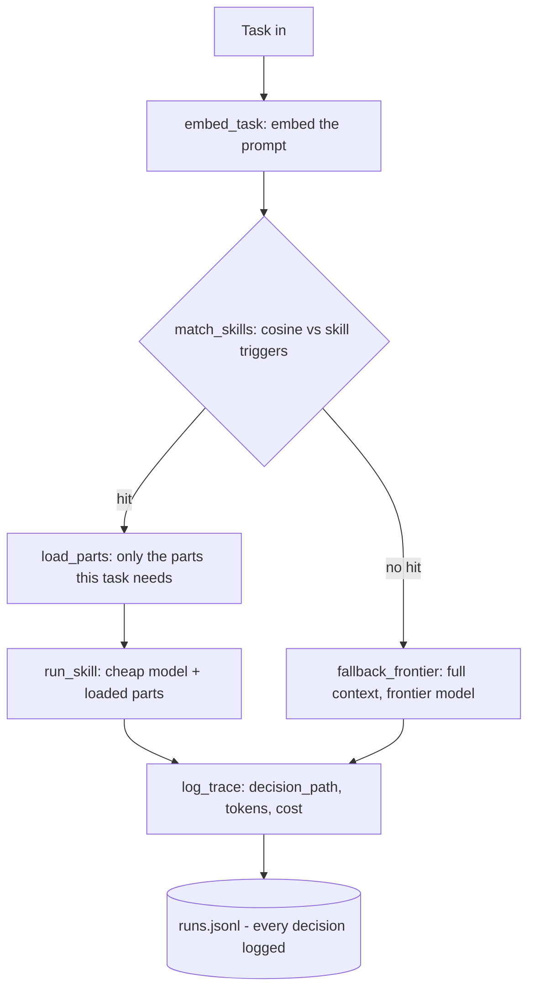
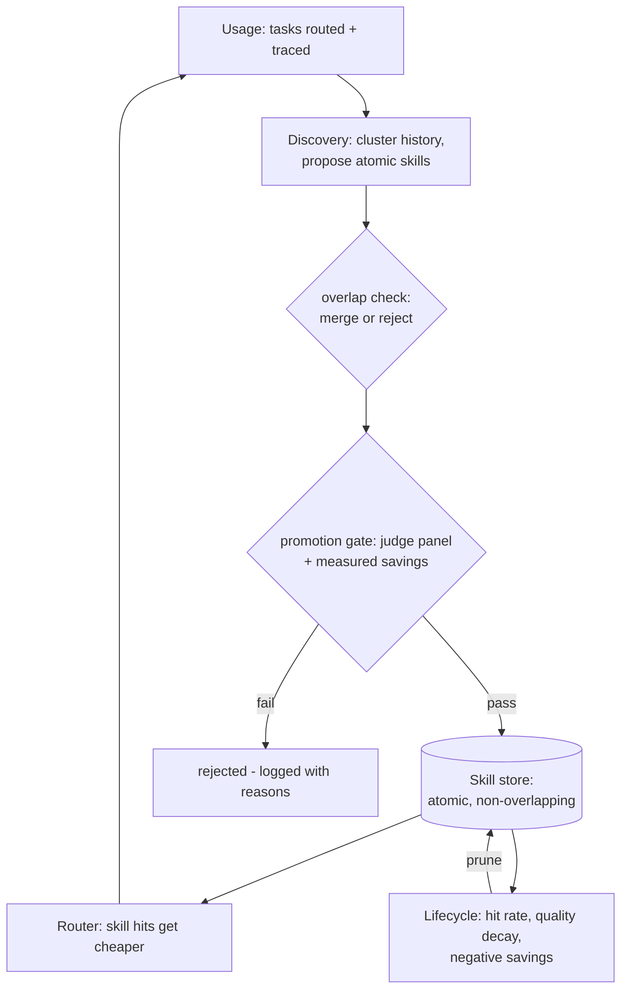

# Muscle Memory for AI Agents

Your coding agent repeats itself. It writes the same kinds of commit messages, explains the same
kinds of stack traces, triages the same kinds of issues - and pays frontier-model prices for
every single one.

**Muscle Memory** watches what your agent actually does, discovers the workflows it repeats
(without being told), compiles them into cheap reusable skills, and prunes the ones that stop
paying off. The longer it runs, the cheaper it gets - and a judge panel proves it doesn't get dumber.

Built at CalHacks 13 (Oct 24-25, 2026). Everything below is from measured live runs
(Claude sonnet-4.5 frontier path, Claude haiku-4.5 skill + judge path, Gemini embeddings) -
no projections, no mock numbers.

## How a task is routed



## How the system learns



No human labels anything. Discovery never sees the corpus's type labels - it clusters raw
prompt+context embeddings. The promotion gate is code, not vibes: a 3-member LLM judge panel
scores the skill path against the frontier path on held-out tasks, and the skill must also
show measured positive savings. Skills are atomic and non-overlapping - the overlap check
merges or rejects lookalikes before they enter the store.

## Measured evidence

From one take: **195 runs, $1.315 total spend, 4 skills promoted, 2 pruned, 36 judged comparisons.**
Every gate decision below is logged in `src/traces/discovery.jsonl` with its scores.

**Example 1 - flat quality at half the cost.** Task: "Write a pytest suite for this utility,
including failure modes." Judge panel: frontier **0.953** vs skill **0.950** - a tie inside the
0.05 margin. The skill path measured **$0.0106/task vs $0.0205 frontier** (-48%).

**Example 2 - the skill beats the frontier model.** Task: "Suggest labels and a priority for
this issue." Judge panel: skill **0.900** vs frontier **0.827** - the focused skill instructions
beat the general model. Measured **$0.0024/task vs $0.0053** (-55%). On a commit-message task
("What's a good git commit message for this diff? Keep it conventional.") the documentation
skill scored **0.923** vs frontier **0.753**. In live routing, changelog tasks - a workflow with
no skill of their own - correctly route to that same code-change-documentation skill.

**Example 3 - the lifecycle retires a bad skill.** The unit-test skill passed the gate
(mean judge **0.768**, measured validation savings $0.0099/task) and was promoted. In production
the lifecycle measured its skilled runs at **$0.0104/run vs $0.0075/run frontier** - the skill's
loaded parts cost more than they saved. It was **pruned automatically**; the decision and the
measured reasons are in `src/traces/lifecycle.jsonl`. The gate judges quality on samples; the
lifecycle keeps score on real traffic, and the skill web shrinks when it should.

The gate also holds the bar by default: on an earlier take, the strict all-pairs-pass rule
**rejected all four candidates**, including one skill that tried to refuse a task outside its
competence. The demo take ran with that rule visibly relaxed to mean-score-only
(`--allow-partial-pass`, same 0.75 bar) - disclosed on screen and in every run summary.

## How it's cheaper

Two multiplicative savings, both measured: the skill path sends **fewer tokens** (loaded skill
parts + task instead of full context) to a **cheaper model** (haiku instead of sonnet). Measured
across the take: **$0.0034/task skilled vs $0.0075/task frontier = 55% cheaper per routed task**,
with quality held flat within the judge's tie margin. Skill runs also load only the parts the
task needs - traces logged `3 of 4` and `2 of 4` parts loaded on real tasks.

## Run it

```bash
pip install -r requirements.txt
export ANTHROPIC_API_KEY=... GEMINI_API_KEY=...   # generation / embeddings
bash demo/live_take.sh                             # the full measured take
streamlit run src/dashboard/app.py                 # dashboard + Proof screen
```

Take configuration used for the numbers above: `MATCH_THRESHOLD=0.68` (tuned on the full-corpus
similarity matrix), `PART_MATCH_THRESHOLD=0.66` (selective part loading), gate
`--allow-partial-pass` (mean judge score >= 0.75). Offline fallback:
`MOCK_LLM=1 MUSCLE_MEMORY_MOCK=1` runs the whole pipeline with no keys.

## Layout

    src/corpus/      task generator + fixtures (the demo workload)
    src/runner/      executor: frontier + skill paths
    src/router/      decision graph, embeddings, selective part loading
    src/discovery/   clustering, skill proposal, overlap check, promotion gate
    src/judge/       3-member judge panel + heuristic offline fallback
    src/lifecycle/   prune logic (keep/retire on measured evidence)
    src/traces/      logged runs, comparisons, lifecycle events (jsonl)
    src/skills/      compiled skills (starts empty - the growth is the demo)
    src/dashboard/   one-screen Streamlit app with the Proof view
    scripts/         run_batch, run_discovery, seed_history
    demo/            live_take.sh + video RUNBOOK

Interface contracts are frozen in INTERFACE.md. All savings/quality claims in the README,
pitch, and Devpost come from measured runs - no projections.
